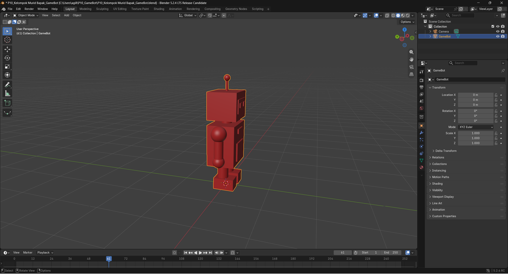
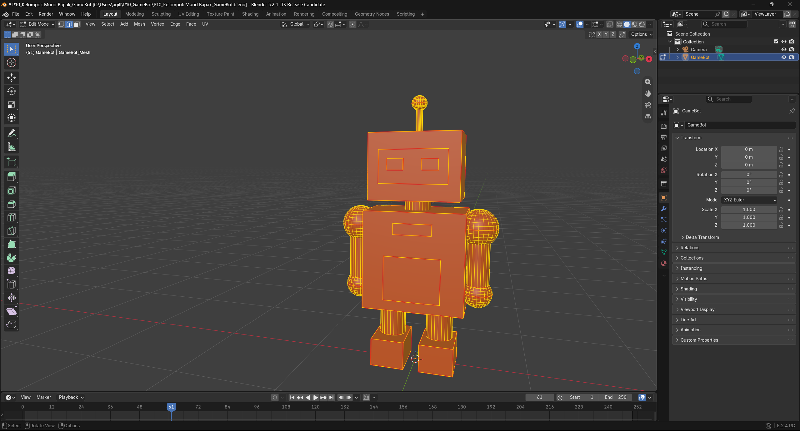
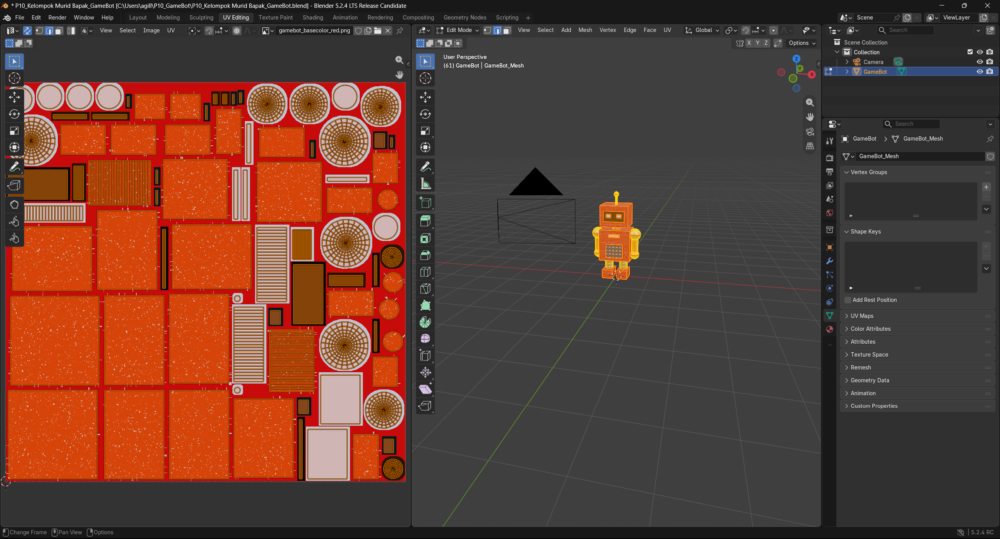
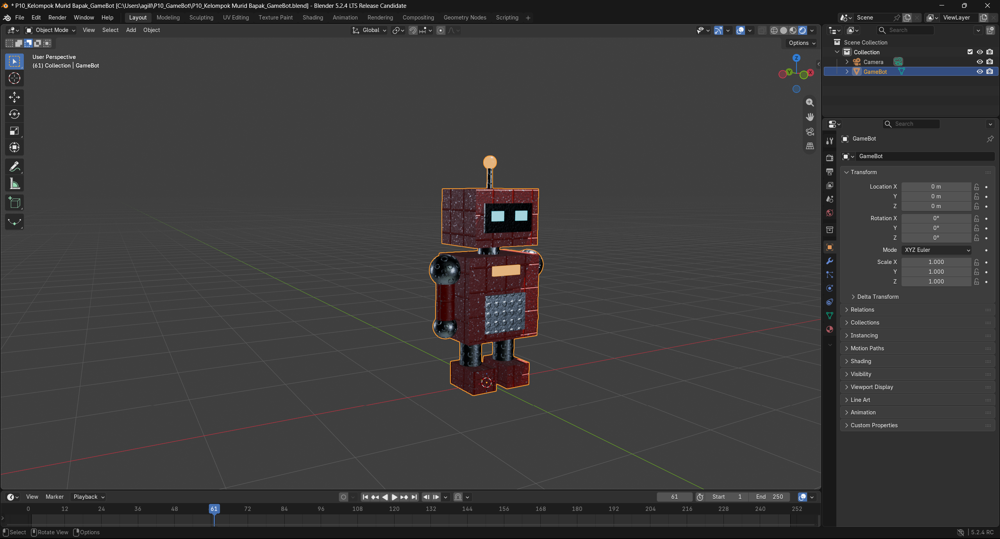
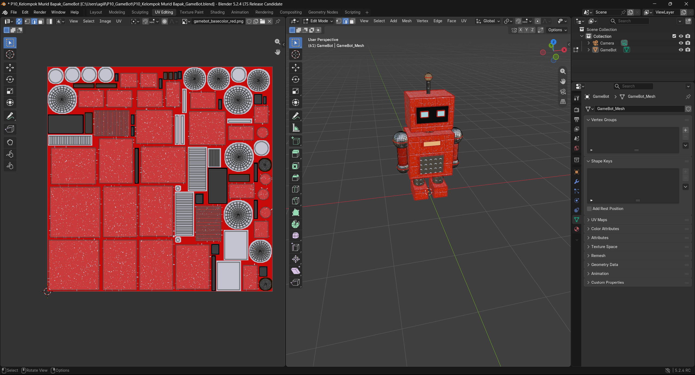
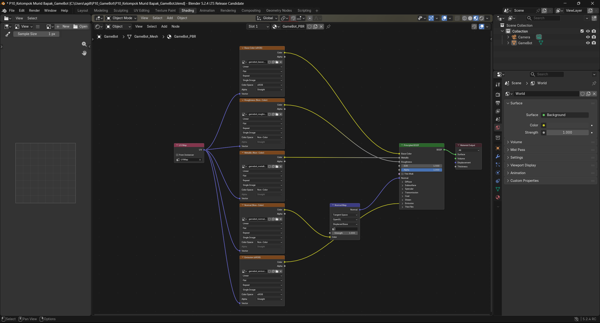
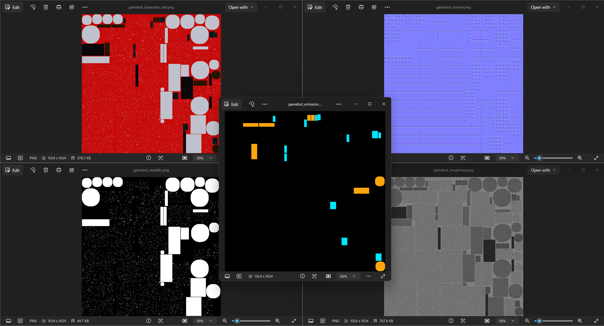
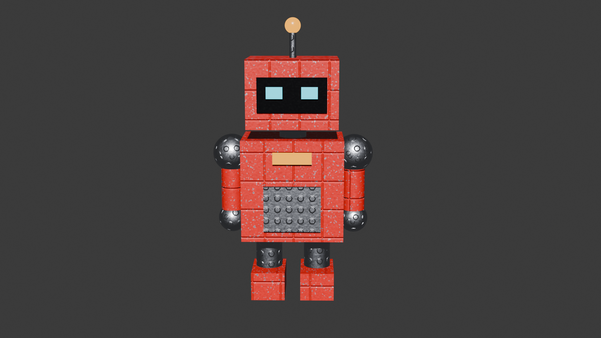
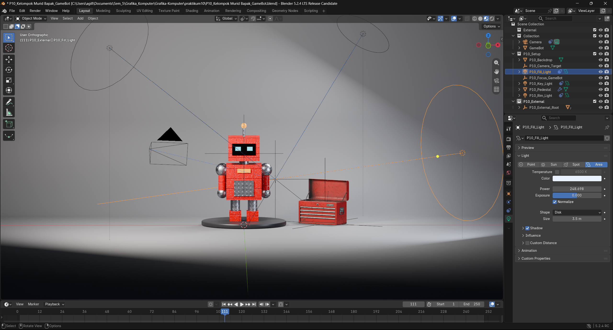

# Praktikum 10
# UV Mapping & PBR Material: GameBot Red Edition

## 1. Identitas Kelompok

| Keterangan | Isi |
|---|---|
| Anggota 1 | Agil Lukman Hakim Muchdi - 5025241037 |
| Anggota 2 | Pradhipta Raja Mahendra - 5025241055 |
| Kelompok | Murid Bapak |
---

## 2. Deskripsi Asset

- **Nama Asset:** GameBot Red Edition
- **Deskripsi:** Robot kecil bergaya game dengan proporsi *chibi* (kepala besar, kaki pendek), badan bercat merah, rangka logam, layar wajah hitam mengkilap, serta mata dan indikator yang menyala.
- **File Blender:** `P10_Kelompok Murid Bapak_GameBot.blend`
- **Asal Asset:** Asset sendiri

### 2.1 Data Model

| Item | Nilai |
|---|---|
| Objek / mesh | `GameBot` / `GameBot_Mesh` (1 objek) |
| Ukuran | 1.44 × 0.69 × 2.50 m (lebar × tebal × tinggi) |
| Geometri | 2.170 vertex, 2.130 face, 4.260 edge |
| Jenis face | 1.878 quad (88%), 240 segitiga, 12 n-gon |
| Modifier | Tidak ada |
| Orientasi | Berdiri di z = 0, menghadap −Y (Front) |

### 2.2 Teknik Modeling

Model dibangun dengan pendekatan **primitive/blocking**: 20 bagian dari bentuk dasar Blender yang diatur ukuran dan posisinya, lalu digabung menjadi satu objek (Join).

| Primitive | Bagian | Jumlah |
|---|---|---|
| Cube | Kepala, badan, layar wajah, mata, indikator dada, panel grill, telapak kaki | 9 |
| Cylinder (24 sisi) | Antena, leher, lengan, kaki | 6 |
| UV Sphere | Bola antena, sendi bahu, tangan | 5 |

Model dibuat **low-poly**. Detail kecil seperti garis panel dan baut tidak dimodelkan, tetapi dibuat dengan normal map. Penggabungan menjadi satu objek membuat seluruh robot cukup memakai satu UV map, satu material, dan satu set tekstur.

Screenshot: `screenshots/01_asset_sebelum_uv.png`



---

## 3. UV Mapping

| Tahap | Yang dilakukan | Hasil |
|---|---|---|
| Seam | Mark Seam manual di sambungan antar-part, bagian tersembunyi, dan sisi belakang | 522 edge seam |
| Unwrap | UV → Unwrap berdasarkan seam | **82 UV island**, dipisah per bagian (kepala, badan, lengan, kaki, rangka) |
| Distortion | Dicek dengan UV Checker (material `GameBot_Checker`). Bagian yang melar diperbaiki dengan menambah seam lalu unwrap ulang | Kotak checker persegi, tidak melar |
| Texel density | **Average Islands Scale** | Ukuran kotak checker seragam di seluruh model |
| Packing | **Pack Islands** dengan margin | Semua island di ruang 0–1, margin ±6–7 px dari tepi (tekstur 1024 px) |

**Alasan penempatan seam:** di sepanjang seam tekstur bisa tidak menyambung mulus, sehingga seam diletakkan di tempat yang tidak terlihat dari sudut pandang utama.

**Alasan margin saat packing:** mencegah warna dari island tetangga ikut tersampel (*texture bleeding*) saat tekstur diperkecil (mipmap).

| Seam | Initial Unwrap |
|---|---|
|  |  |

| Checker Test | Final UV Layout |
|---|---|
|  |  |

---

## 4. PBR Material dan Texture Maps

Material `GameBot_PBR` memakai **Principled BSDF** dengan 5 texture map berukuran **1024 × 1024**. Semua map membaca node **UV Map** yang sama.

| Map | Color Space | Terhubung ke | Isi |
|---|---|---|---|
| Base Color | sRGB | Base Color | Merah cat (0.78, 0.04, 0.04), abu logam (0.75, 0.76, 0.80) |
| Roughness | Non-Color | Roughness | Layar 0.22, logam 0.35, cat 0.46 (rata-rata), dengan noise halus |
| Metallic | Non-Color | Metallic | Biner: 1 = logam, 0 = cat/layar |
| Normal | Non-Color | Normal Map node → Normal | Garis panel dan baut, ±90% area datar |
| Emission | sRGB | Emission Color (Strength 2.0) | Mata cyan, indikator oranye, sisanya hitam |

### 4.1 Penjelasan Color Space

- **sRGB** untuk map yang berisi *warna yang dilihat mata* (Base Color, Emission).
- **Non-Color** untuk map yang berisi *data angka* (Roughness, Metallic, Normal). Jika dibaca sebagai sRGB, nilainya terkena kurva gamma dan bergeser. Contohnya roughness 0.46 akan terbaca sekitar 0.18, sehingga cat terlihat jauh lebih mengkilap.

### 4.2 Roughness

Roughness memakai **map**, bukan satu nilai, sehingga setiap bagian punya kekasaran sendiri:

| Area | Rata-rata | Rentang | Kesan |
|---|---|---|---|
| Layar wajah | 0.22 | 0.08 – 0.37 | Mengkilap seperti kaca |
| Logam | 0.35 | 0.27 – 0.46 | Mengkilap, pantulan agak buram |
| Cat merah | 0.46 | 0.38 – 0.58 | Semi-doff |

Variasi di dalam tiap area menghindari tampilan yang terlalu sempurna ("plastik CGI").

### 4.3 Normal Map

| Item | Nilai |
|---|---|
| Node | Normal Map: **Tangent Space**, **OpenGL**, Strength **1.0** |
| Warna dasar | RGB (0.5, 0.5, 1.0), yaitu arah normal (0, 0, 1) lurus keluar |
| Detail | Garis panel pada kepala/badan dan baut pada panel grill |

Normal map mengubah arah normal per piksel sehingga cahaya jatuh seolah ada lekukan, **tanpa menambah polygon**. Node Normal Map diperlukan untuk mengubah warna 0–1 menjadi vektor −1 sampai 1 dalam tangent space. Blender memakai konvensi **OpenGL**; normal map DirectX memiliki channel hijau terbalik.

### 4.4 Pembagian Material

| Kelompok | Bagian |
|---|---|
| Cat merah (non-logam) | Kepala, badan, lengan, telapak kaki |
| Logam | Sendi bahu, tangan, leher, kaki, antena, panel grill |
| Layar (non-logam, mengkilap) | Wajah |
| Emission | Mata (cyan), indikator dada (oranye) |

| Node Graph | Texture Maps |
|---|---|
|  |  |

---

## 5. Challenge

1. **Metal + Painted Surface**: logam dan cat dipisahkan lewat Metallic map (1 vs 0) dan Roughness map (logam 0.35 lebih mengkilap dibanding cat 0.46).
2. **Custom Emission Mask**: emission hanya aktif pada mata (cyan) dan indikator (oranye); area hitam pada map tidak menyala.



---

## 6. Scene Final

### 6.1 Model Sendiri

GameBot Red Edition (bagian 2–5): model, UV mapping, material, dan tekstur dibuat sendiri.

### 6.2 Model Eksternal

| Keterangan | Isi |
|---|---|
| Nama Model | Metal Tool Chest |
| Sumber | https://polyhaven.com/a/metal_tool_chest |
| Lisensi | CC0 (domain publik) |
| Format | glTF, tekstur 1K |
| Texture Map | Diffuse/Base Color, Roughness, Metallic, Normal (GL), Ambient Occlusion. Emission tidak tersedia |

Material `External_PBR` dibangun ulang dengan aturan yang sama seperti GameBot:

| Map | Color Space | Terhubung ke |
|---|---|---|
| Diffuse | sRGB | Base Color (dikalikan AO) |
| Ambient Occlusion | Non-Color | **Multiply** dengan Base Color |
| Roughness | Non-Color | Roughness |
| Metallic | Non-Color | Metallic |
| Normal GL | Non-Color | Normal Map → Normal |

Principled BSDF tidak memiliki input AO, sehingga AO di-*multiply* ke Base Color agar celah-celah model lebih gelap.

### 6.3 Komposisi

| Elemen | Pengaturan |
|---|---|
| GameBot | Fokus utama, di tengah, berdiri di atas **pedestal** bundar gelap |
| Model eksternal | Tinggi 1.1 m, di kanan GameBot, sedikit ke belakang (memberi kedalaman), diputar −30° ke arah kamera |
| Ground + backdrop | Lantai yang melengkung menjadi dinding (cyclorama) agar latar bersih tanpa sudut tajam |
| Objek uji coba lama | Cube dan Sun lama disembunyikan dari render |

### 6.4 Lighting – Three-Point Lighting

| Lampu | Tipe | Posisi | Warna | Fungsi |
|---|---|---|---|---|
| Key Light | Area (disk) | Kiri-depan, tinggi | Hangat (1.00, 0.93, 0.85) | Cahaya utama, membentuk volume dan bayangan |
| Fill Light | Area (disk) | Kanan-depan, rendah | Dingin (0.82, 0.88, 1.00) | Melembutkan bayangan |
| Rim Light | Area (disk) | Belakang-kanan | Putih | Memisahkan siluet dari latar |
| World | Background | – | Abu-abu sangat gelap | Cahaya ambient tipis |

Power tiap lampu: _(salin dari `laporan_scene_final.md`)_.

Area Light dipakai karena sumber cahaya yang luas menghasilkan bayangan yang lembut. Perbedaan warna hangat dan dingin memberi kontras dan kedalaman. Lampu juga penting untuk material logam, karena logam hanya memantulkan lingkungannya.

### 6.5 Kamera

| Parameter | Nilai |
|---|---|
| Focal length | 50 mm (sensor 36 mm), mendekati pandangan mata |
| Sudut pandang | Kiri-depan (azimuth −22°), elevasi 10° |
| Framing | Otomatis, kedua model masuk frame dengan ruang di sekelilingnya |
| Depth of Field | f/4, fokus ke wajah GameBot |

### 6.6 Render

| Parameter | Nilai |
|---|---|
| Engine | Eevee (raytracing aktif) |
| Resolusi | 1920 × 1080 |
| Samples | 64 |
| Color Management | AgX, Medium High Contrast |



Hasil render menunjukkan perbedaan material pada setiap model: cat merah GameBot yang semi-doff, sendi logam yang memantulkan cahaya, layar wajah yang mengkilap, mata yang menyala, serta permukaan logam model eksternal dengan detail dari normal map dan AO.

---

## 7. Kendala dan Solusi

| Kendala | Penyebab | Solusi |
|---|---|---|
| Hasil render (F12) gelap, padahal viewport terlihat terang | Material Preview memakai HDRI studio bawaan Blender yang tidak ikut ke render, sedangkan scene tidak punya lampu | Menambahkan three-point lighting (Key, Fill, Rim) |
| Viewport mode Solid tidak menampilkan tekstur | Mode Solid tidak membaca material | Memakai Material Preview / Rendered |
| Material eksternal terlihat salah | Map Roughness, Metallic, dan Normal masih sRGB | Mengubah color space menjadi Non-Color |
| Objek uji coba menutupi GameBot | Objek baru muncul di 3D cursor dengan ukuran default | Diperkecil dan dipindah, lalu disembunyikan dari render final |
| Shortcut numpad tidak bisa dipakai | Laptop tanpa numpad | Mengaktifkan **Emulate Numpad** (Preferences → Input) atau memakai menu View |
| Script gagal: objek GameBot tidak ditemukan | Script dijalankan di file Blender baru yang kosong | Membuka file .blend GameBot terlebih dahulu |
| Script gagal: model eksternal tidak ditemukan | Path file model tidak sesuai lokasi | Menaruh model di folder `external/` di samping file .blend dan menyesuaikan path |
| Pembagian waktu | Jadwal anggota berbeda | Membagi tugas per bagian lalu review bersama |

---

## 8. Hasil Akhir

GameBot Red Edition telah melalui proses modeling, UV mapping, dan penerapan PBR material dengan lima texture map. UV yang dipisah per bagian dengan texel density seragam membuat tekstur menempel tanpa melar, dan pemakaian color space yang benar membuat setiap material bereaksi terhadap cahaya sesuai sifat fisiknya. Pada scene final, GameBot digabungkan dengan model eksternal ber-PBR lengkap, disusun dengan pedestal dan backdrop, diterangi three-point lighting, dan dirender dengan Eevee.

**Pengembangan selanjutnya:** tekstur 2K untuk close-up, AO map untuk GameBot, dan bevel kecil pada tepi kubus agar pantulan tepi lebih realistis.


---

## 9. Struktur Repository

```text
praktikum10/
├── P10_Kelompok Murid Bapak_GameBot.blend
├── Readme.md
├── p10_scene_setup.py            # script penyusun scene final
├── laporan_scene_final.md        # ringkasan angka scene (dibuat otomatis)
├── textures/                     # tekstur GameBot
│   ├── gamebot_basecolor_red.png
│   ├── gamebot_roughness.png
│   ├── gamebot_metallic.png
│   ├── gamebot_normal.png
│   └── gamebot_emission.png
├── external/                     # model eksternal (Poly Haven, CC0)
│   ├── metal_tool_chest_1k.gltf
│   └── textures/
└── screenshots/
    ├── 01_asset_sebelum_uv.png
    ├── 02_marked_seam.png
    ├── 03_initial_unwrap.png
    ├── 04_checker_test.png
    ├── 05_final_uv_layout.png
    ├── 06_pbr_node_graph.png
    ├── 07_texture_maps.png
    ├── 08_challenge.png
    ├── 09_final_material.png
    └── 11_final_render.png
```

---